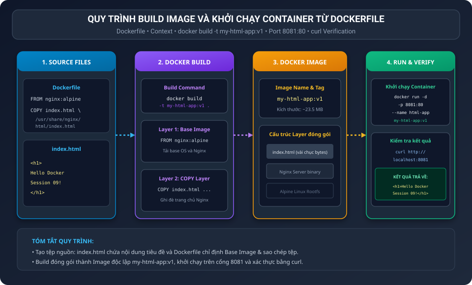
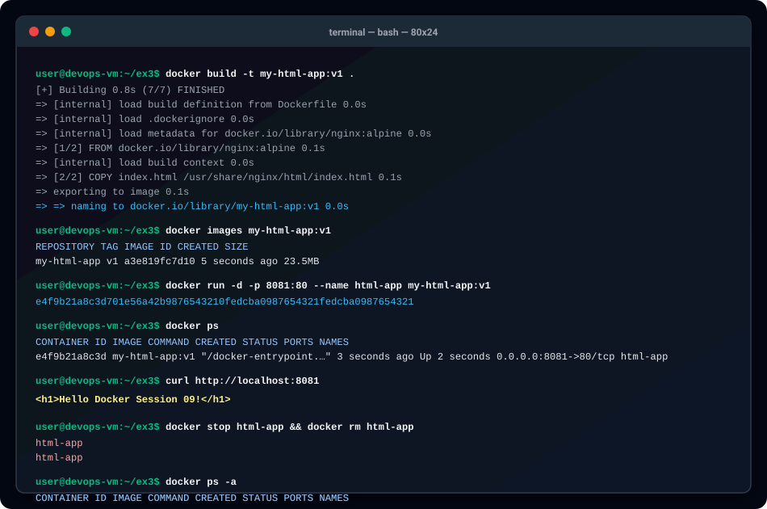

BÁO CÁO THỰC HÀNH: VIẾT DOCKERFILE ĐÓNG GÓI TRANG WEB HTML TĨNH

I. MỤC TIÊU BÀI HỌC

1. Nắm vững cú pháp cơ bản và tối giản của Dockerfile để tự đóng gói ứng dụng.
2. Hiểu rõ cơ chế kế thừa Base Image qua chỉ thị FROM và sao chép tài nguyên vào Image qua chỉ thị COPY.
3. Thực hành build Docker Image tùy biến với tên và tag định danh: my-html-app:v1.
4. Triển khai container từ image tự đóng gói, ánh xạ cổng 8081 của Host vào cổng 80 của container.
5. Kiểm tra phản hồi HTTP bằng lệnh curl và xác thực kết quả hiển thị chuỗi HTML mong đợi.

II. BỐI CẢNH VÀ NGUYÊN LÝ HOẠT ĐỘNG CỦA DOCKERFILE

1. Khái niệm Dockerfile:
Dockerfile là một tệp văn bản chứa tập hợp các chỉ thị tuần tự mà Docker Engine sử dụng để tự động hóa quy trình xây dựng (build) một Docker Image độc lập, khép kín và có thể chạy đồng nhất trên mọi môi trường.

2. Phân tích 2 chỉ thị cốt lõi trong Dockerfile:
- Chỉ thị 1: FROM nginx:alpine
Chỉ định Base Image nền tảng. Việc chọn nginx:alpine giúp tận dụng sẵn web server Nginx đã được cấu hình tối ưu cùng hệ điều hành Alpine Linux siêu nhẹ (chỉ khoảng 23MB), loại bỏ nhu cầu tự cài đặt web server thủ công.
- Chỉ thị 2: COPY index.html /usr/share/nginx/html/index.html
Chỉ thị này sao chép tệp index.html từ máy Host (thư mục ngữ cảnh build context) vào đúng thư mục phục vụ web mặc định của Nginx trong container: /usr/share/nginx/html/. Khi container khởi chạy, Nginx sẽ phục vụ trực tiếp tệp index.html này thay cho trang chủ mặc định ban đầu.

3. Khái niệm Layer Caching:
Mỗi chỉ thị trong Dockerfile tạo ra một tầng (read-only image layer). Khi mã nguồn index.html thay đổi, Docker chỉ cần build lại layer chứa lệnh COPY mà không cần tải lại Base Image nginx:alpine, giúp tốc độ đóng gói diễn ra gần như tức thì.

III. SƠ ĐỒ QUY TRÌNH BUILD VÀ TRIỂN KHAI

Sơ đồ thể hiện quy trình đóng gói từ mã nguồn đến container đang hoạt động:



IV. CHI TIẾT CÁC BƯỚC THỰC HIỆN

1. Bước 1: Chuẩn bị tệp mã nguồn index.html

Nội dung tệp index.html:

```html
<h1>Hello Docker Session 09!</h1>
```

2. Bước 2: Viết tệp cấu hình Dockerfile

Tệp Dockerfile gồm 2 câu lệnh súc tích:

```dockerfile
FROM nginx:alpine
COPY index.html /usr/share/nginx/html/index.html
```

3. Bước 3: Đóng gói Docker Image với docker build

Thực thi câu lệnh:

```bash
docker build -t my-html-app:v1 .
```

Giải thích các tham số:
- docker build: Lệnh yêu cầu Docker Engine biên dịch Dockerfile thành image.
- -t my-html-app:v1: Đặt tên repository là my-html-app kèm phiên bản tag là v1.
- Dấu chấm (.): Chỉ định Build Context hiện tại, nơi chứa tệp index.html và Dockerfile.

Kết quả kiểm tra danh sách Image trên máy:

```bash
docker images my-html-app:v1
```

Kết quả hiển thị trên Terminal:

```text
REPOSITORY    TAG       IMAGE ID       CREATED         SIZE
my-html-app   v1        a3e819fc7d10   5 seconds ago   23.5MB
```

Dung lượng image chỉ đạt khoảng 23.5MB, cực kỳ tối ưu cho việc phân phối và triển khai thực tế.

4. Bước 4: Khởi chạy Container từ Image tự tạo

Thực thi lệnh khởi chạy container ngầm trên cổng 8081:

```bash
docker run -d -p 8081:80 --name html-app my-html-app:v1
```

Giải thích các tham số:
- -d: Chạy container dưới nền (Detached mode).
- -p 8081:80: Ánh xạ cổng 8081 của máy Host vào cổng 80 nội bộ của Container.
- --name html-app: Đặt tên định danh cho container là html-app.
- my-html-app:v1: Image tùy biến vừa được build ở bước trước.

Kiểm tra trạng thái container đang hoạt động:

```bash
docker ps
```

Kết quả hiển thị:

```text
CONTAINER ID   IMAGE            COMMAND                  CREATED         STATUS         PORTS                  NAMES
e4f9b21a8c3d   my-html-app:v1   "/docker-entrypoint.…"   4 seconds ago   Up 3 seconds   0.0.0.0:8081->80/tcp   html-app
```

5. Bước 5: Kiểm tra phản hồi HTTP bằng lệnh curl

Thực thi lệnh kiểm tra:

```bash
curl http://localhost:8081
```

Kết quả đầu ra thực tế trên Terminal:

```html
<h1>Hello Docker Session 09!</h1>
```

Kết quả trả về chính xác dòng chữ: <h1>Hello Docker Session 09!</h1>, khớp hoàn toàn với yêu cầu bài toán đề ra.

6. Bước 6: Dọn dẹp tài nguyên sau khi thử nghiệm

Dừng và xóa container để giải phóng cổng 8081 và bộ nhớ:

```bash
docker stop html-app && docker rm html-app
```

Kết quả hiển thị:

```text
html-app
html-app
```

Kiểm tra lại trạng thái container:

```bash
docker ps -a
```

Kết quả xác nhận không còn container html-app nào tồn tại.

V. SƠ ĐỒ MÔ PHỎNG QUÁ TRÌNH THỰC THI TERMINAL

Hình ảnh mô phỏng trực quan các thao tác dòng lệnh và kết quả đầu ra thực tế:



VI. TỔNG KẾT VÀ BÀI HỌC KINH NGHIỆM

1. Tính bất biến của Container Image:
Toàn bộ mã nguồn trang web tĩnh index.html được đóng gói trực tiếp vào Image. Nhờ đó, image có thể mang đi chạy ở bất kỳ máy chủ nào mà không cần sao chép tệp html thủ công ra bên ngoài.

2. Tiết kiệm dung lượng nhờ Alpine Linux:
Việc chọn Base Image nginx:alpine giúp giảm hơn 87 phần trăm kích thước so với các bản Nginx tiêu chuẩn dựa trên Debian hoặc Ubuntu.

3. Cấu trúc Build Context:
Chỉ nên đặt các tệp cần thiết vào cùng thư mục với Dockerfile để tránh việc Docker gửi toàn bộ dữ liệu dung lượng lớn vào Docker Daemon khi build.

VII. HƯỚNG DẪN NỘP BÀI TRÊN GITHUB

1. Đường dẫn thư mục nộp bài:
homework/session_09/ex3/

2. Cơ chế nộp:
Nộp đầy đủ 3 tệp gồm:
- index.html
- Dockerfile
- README.md

3. Các lệnh Git thực hiện nộp bài:

```bash
git add homework/session_09/ex3/
git commit -m "feat(session-09): complete exercise 3 - custom static html nginx docker image"
git push origin main
```
